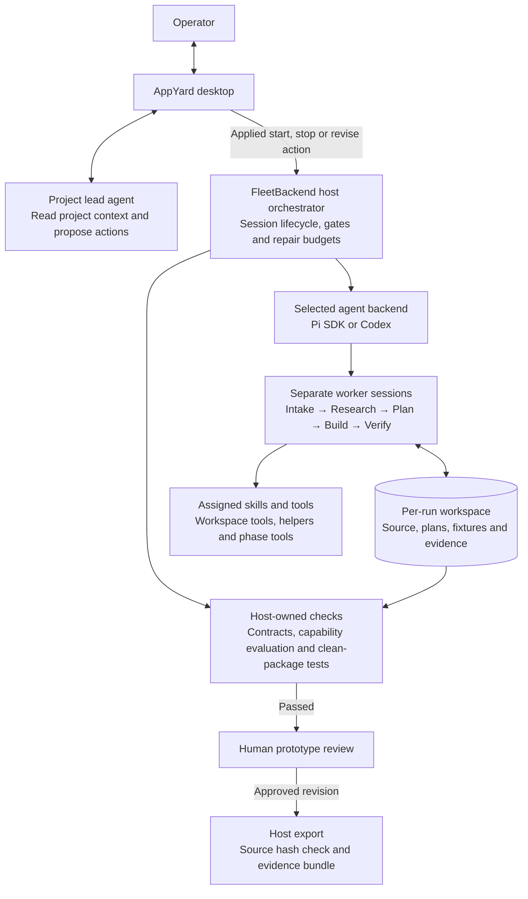

# AppYard agent architecture

Current implementation, checked against the working tree on November 5, 2026. The Electron host starts and sequences role-specific sessions, enforces contracts and repair budgets, and records evidence. Each run uses either Pi or Codex as its agent backend.

## Control and execution

The Project lead runs separately from factory workers. It can read project context and propose actions; the operator applies those proposals in the desktop app. Its model session also uses the selected Pi or Codex backend. Only the host starts worker sessions.

## Worker lifecycle and gates

Rectangles identify agents or host operations; diamonds identify checks. The host controls every transition.

```mermaid
flowchart TB
    brief["Brief and supplied inputs"] --> intake["Requirements analyst<br/>Scope and data needs"]
    intake -->|Inputs attached| research["Reuse researcher<br/>Supplied evidence and reuse decisions"]
    intake -->|No inputs attached| synthetic["Synthetic data specialist<br/>Separate agent session"]
    synthetic --> data["Host validates and freezes fixtures"]
    data --> research
    research --> planner["Implementation planner<br/>Architecture, contracts and test plans"]
    planner --> planReview{"Independent planning reviewer<br/>Read-only snapshot"}
    planReview -->|Revise| planner
    planReview -->|Approve| freeze["Host freezes contracts<br/>Seals answer keys and copies foundation"]

    subgraph build["Implementation agent — one session with host checkpoints"]
        direction TB
        core["Implement computational core"] --> coreGate{"Host core evaluation"}
        coreGate -->|Repair within budget| core
        coreGate -->|Pass| workflow["Implement first primary user workflow"]
        workflow --> workflowGate{"Host primary-workflow check<br/>Desktop and narrow viewports"}
        workflowGate -->|Repair within budget| workflow
        workflowGate -->|Pass| complete["Complete app, visual reviews and user guide"]
    end

    freeze --> core
    complete --> verifier["Verifier agent<br/>Inspect, test, repair and document"]
    verifier --> finalGate{"Host final verification<br/>Capabilities, tests, journeys and visual evidence"}
    finalGate -->|Fresh verifier repair session| verifier
    finalGate -->|Pass| human["Human prototype review"]
    human -->|Approve revision| delivery["Host packages source and evidence"]
```

Core, primary-workflow and final verification each have their own allowance: **three repairs, fifteen active minutes**, and an early stop after **two consecutive checks without semantic progress**. Consumption survives resume. Exhausting a gate stops the build before review. Planning revision and independent re-review repeat until approval within the applicable execution limits; they do not use this three-repair allowance.

CLI applications use the callable-core checkpoint and skip browser journeys and visual reviews. Browser and service applications require desktop and narrow viewport evidence. The final host verification checks the finished source independently after the verifier agent completes.

## Tools, artifacts and clarification

| Boundary | Responsibility |
| --- | --- |
| Worker tools | Global `read`, `write`, `edit`, `bash`, `fleet_helpers` and `fleet_run_helper`, extended by assigned phase tools and skills. |
| Research and planning | Supplied-evidence search, architecture publication and plan validation as assigned; both can request structured clarification. |
| Build and verification | Domain tools, component progress, host-managed browser interaction and visual-review recording. |
| Project helpers | Agent-created Node utilities, tested before execution in a separate sandbox. Network is disabled; persistent output is confined to `.agent-output/`. |
| Frozen contracts | Public solution, acceptance and UX contracts remain available to the builder. Evaluation answer keys are sealed outside its workspace during implementation and verification. |
| Host evidence | Trusted verification snapshots, repair state and source hashes determine gate results. Agent-written reports do not determine a pass. |
| Human review and delivery | The operator approves a specific prototype revision. The host checks the approved source hash before export. |

Research or planning can pause for clarification. The host closes the model session while waiting for the operator's structured answers, then starts a fresh session for that same phase. Project lead chat can explain a question; an ordinary chat reply does not submit its answer.

## Code map

| Concern | Source |
| --- | --- |
| Role contracts, ownership and tool assignments | [`harness/phases.ts`](../harness/phases.ts) |
| Scheduling, backend selection, planning review and gate sequencing | [`electron/pi-backend.ts`](../electron/pi-backend.ts) |
| Common session lifecycle, deadlines and cancellation | [`electron/agent-runner.ts`](../electron/agent-runner.ts) |
| Codex session adapter | [`electron/codex-session.ts`](../electron/codex-session.ts) |
| Project lead conversation and action proposals | [`electron/conversation.ts`](../electron/conversation.ts) |
| Repair limits and progress accounting | [`electron/functional-repair.ts`](../electron/functional-repair.ts) |
| Independent quality checks | [`electron/quality.ts`](../electron/quality.ts) |
| Early user-workflow checkpoint | [`electron/workflow-checkpoint.ts`](../electron/workflow-checkpoint.ts) |
| Helper discovery and sandbox execution | [`electron/agent-helpers.ts`](../electron/agent-helpers.ts) |
| Approved-source export | [`electron/source-export.ts`](../electron/source-export.ts) |

Related details: [functional repair loops](functional-build-loop.md), [Project lead and clarification](project-conversation.md), [agent-created helpers](agent-helpers.md), and [per-application system design](system-design.md).
