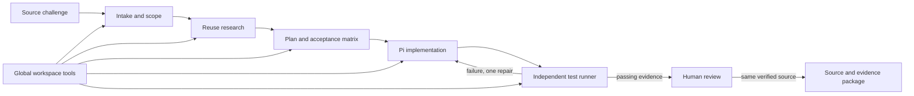

# FleetHarness challenge pipeline

FleetHarness now connects the Norfolk challenge catalog to Pi planning, implementation, verification and reviewed delivery. The pipeline chooses domain-specific skills and deterministic tools; each generated application keeps its own architecture.

The catalog contains all **34 challenge IDs** visible on the [Norfolk use-case page](https://cdao.hackathon.maximus.com/event/norfolk/use-cases), captured November 4, 2026. The site required an authenticated browser. Titles and displayed categories were retained; summaries and requirement interpretations were paraphrased. Challenges 11, 12 and 36 were additionally checked against their detail-page requirements. `sourceScope` records that distinction, and missing category badges remain `null`. Recipe assignments and acceptance tests are FleetHarness engineering decisions, not statements by the event organizers.

## Run it

Use Node 22.19 or later for the complete Pi development environment. The packaged desktop application includes its own runtime. From the repository:

```sh
npm run harness -- catalog
npm run harness -- plan 12
npm run harness -- plan 11 --out .fleet-runs/pb4t
npm run harness -- demo --out output/pipeline-demo
npm run test:harness
```

The CLI's `plan` command prepares a source-linked packet and reference toolkit. It does not claim that an AI has researched or implemented the application. `demo` executes eleven deterministic checks across six tool scenarios without a model, credential or network request; its report is explicitly toolkit-only. Use a fresh output directory for each demo report.

To call a tool with a JSON input:

```sh
npm run --silent harness -- fixture fleet_extract_messages > /tmp/fleet-message.json
npm run --silent harness -- tool fleet_extract_messages --input /tmp/fleet-message.json
```

In the desktop app, create a challenge from the catalog, review its scope, connect a Pi model in settings, and start the run. Each run gets a separate workspace. Separate intake, research and planning sessions write the scope, reuse decisions, implementation plan and test matrix; implementation produces a standalone browser application and testable core; verification inspects and tests it. The host independently runs Node tests and allows one repair attempt. The operator reviews the result before exporting a package.

## Pipeline contracts



| Stage | Required output | Exit condition |
|---|---|---|
| Intake | Original requirements, `.fleet/packet.json`, derived `scope.md` | Source requirements, requested slice, data boundary and unknowns are explicit |
| Research | `research.md` | Primary-source leads and adopt/adapt/reject decisions; untested integrations labeled |
| Plan | `plan.md`, `test-matrix.md` | Task dependencies and a test/manual check or explicit gap for every criterion |
| Build | `index.html`, core modules, tests, `README.md` user guide | Runnable vertical slice, followed by a guide to setup, workflows, sample inputs and results, data handling, troubleshooting and limitations |
| Verify | `verification.md`, host-owned test report | Actual tests pass and the guide matches the final application; missing/skipped tests and changed source cannot claim verification |
| Review | Host-recorded decision | Human inspects the exact verified revision and limitations |
| Deliver | Source/evidence bundle, `path-to-fleet.md` | Source still matches verification and approval; setup and remaining dependencies documented |

The runtime runs intake, research, planning, implementation and verification as separate, sequential agent sessions. Only one phase is active per run. Required artifacts and immutable inputs are checked before advancing. Planning must publish the application architecture before building begins. A fresh run preserves prior work by using a new directory. Sessions have bounded turns/time and verification has a process timeout; failed verification remains visible.

Once implementation artifacts exist, the build session receives a dedicated prompt to write the application's `README.md` user guide. The guide must exist before verification starts, and missing/empty output gets one completion attempt within the build session's original budget. Verification and repair update the guide to match the actual application before independent tests bind the final source revision. The guide is available with the run's artifacts and is included in delivery exports.

## Challenge families

| Recipe | Source challenge IDs | Implementation direction |
|---|---|---|
| Messages | 12, 22, 24 | Exact-span structured extraction; OCR and template matching are separate work for scans |
| Scheduling | 11 | Explicit candidate starts, roster constraints, feasibility and infeasibility explanations |
| Offline | 36, 44, 45 | Durable edits, immutable revision merging, reviewed conflict resolution, resumable transfers |
| Knowledge | 15, 20, 21, 33, 34, 39, 46 | Approved-source retrieval, freshness, exact citations and applicability review |
| Readiness | 13, 14, 19, 26, 32 | Source reconciliation, reviewed dependency graphs, unknown estimates and deadline margin |
| Cyber | 18, 25, 35 | Offline evidence, analyst handoff and staged changes with approval/rollback |
| Governance | 9, 16, 23 | Simulation-only agent contracts, resource leases, authority and halt behavior |
| Workflow | 8, 40, 41, 42, 43, 48 | Versioned records, routing, state transitions and explicit release authority |
| Physics | 10, 17 | Authoritative equations and SME reference cases before implementation |
| Fielding | 37 | Owner-supplied app, installation evidence, hosting and sustainment handoff |

Related IDs are retained rather than collapsed: an umbrella challenge and a narrower submission can share building blocks while keeping different source requirements and transition owners.

## Included skills and tools

Fourteen skills live under `skills/`: intake, research, planning, evidence, messages, scheduling, offline, knowledge, readiness, cyber, governance, workflows, physics and delivery. The workspace contains the union of assigned skills; each agent session loads only the skills allotted to its phase. Human review and delivery list reference guidance but do not launch agent sessions. Skills describe decision boundaries and domain invariants; TypeBox schemas and the code enforce tool inputs.

### Tool hierarchy

`harness/phases.ts` defines two levels of tool access. The packet saves `globalTools` once, while each phase's `tools` contains only its additional tools. Effective access is the deduplicated union of both lists. A fresh Pi session receives exact tool names, never the `fleet_*` wildcard; the Codex adapter receives only the selected custom tools alongside its native workspace tools.

**Global tools:** `read`, `write`, `edit`, `bash`. These workspace capabilities are inherited by every agent phase. They do not imply permission to deploy, change requirements or access operational systems, and phase allocation is not an OS sandbox.

| Phase | Assigned skills | Additional phase tools |
|---|---|---|
| Intake | Intake | `fleet_get_challenge` |
| Research | Research, evidence, recipe domain skills | `fleet_search_evidence` |
| Plan | Planning, evidence, recipe domain skills | `fleet_system_design` |
| Build | Recipe domain skills, evidence, delivery | Recipe domain tools, `fleet_component_progress` |
| Verify / repair | Evidence, recipe domain skills | Recipe domain tools, `fleet_component_progress` |
| Human review | Evidence guidance | No agent tools; preview, evidence and approval controls |
| Deliver | Delivery guidance | No agent tools; host integrity check and export |

For example, a scheduling build adds `fleet_solve_schedule`; a message build adds `fleet_extract_messages` and `fleet_search_evidence`. The host independently runs tests during verification. A repair stays within verification's allocation and is limited to one attempt.

The build flow in both interfaces exposes global tools, phase-specific tools, skills, inputs, outputs and the completion gate. Each run persists its assignments with the source packet. Older runs without saved assignments show the proposed assignments for the next run explicitly.

| Pi tool | Actual behavior | Boundary |
|---|---|---|
| `fleet_get_challenge` | Read the captured catalog and recipe | Does not refresh the event website |
| `fleet_extract_messages` | Parse synthetic EVENT/TASK lines with exact offsets | Not full USMTF, OCR or semantic extraction |
| `fleet_solve_schedule` | Bounded hard-constraint feasibility search | No invented fatigue policy, automatic recurrence or optimality claim |
| `fleet_reconcile_records` | Merge immutable histories and retain conflicting heads | No persistence, authentication or network transport |
| `fleet_plan_uploads` | Allocate a byte budget from acknowledged offsets | Does not transmit or acknowledge bytes |
| `fleet_search_evidence` | Filter and rank supplied approved documents lexically | No live source connector or semantic answer generation |
| `fleet_analyze_dependencies` | Calculate a DAG's timing, path and deadline margin | No validated mission-capability model or shared-resource solver |

All tools are local, deterministic transformations of supplied data. Input schemas reject extra properties, payload size is bounded, and outputs identify their scope. The matching dependency-free calculation modules are copied into `.fleet/toolkit/` for generated applications to reuse. They do not impose a common runtime on delivered apps.

## Integration points

- `harness/catalog.ts`: typed catalog, `getChallenge`, and `toProjectInput` for the desktop picker.
- `harness/recipes.ts`: approaches, selected skills/tools, component candidates, acceptance criteria and limitations.
- `harness/phases.ts`: global tools, phase-specific tools, skills, owners and completion gates.
- `harness/planner.ts`: packet composition and stage-specific instructions.
- `harness/integration.ts`: `prepareFleetWorkspace`, `fleetStagePrompt`, `assertFleetPacketIntegrity`.
- `harness/pi-tools.ts`: `createFleetTools()` for Pi `customTools`.
- `harness/tool-registry.ts`: input schemas and a shared invocation path for Pi and the CLI.
- `harness/tools/`: reusable deterministic primitives without Pi dependencies.

The host retains `packetHash` outside the agent workspace and rechecks context integrity before accepting verification. Changing a skill, source packet or reference toolkit invalidates that context, even if the editable manifest hash is forged. Original requirements are checked separately by the desktop host. Verification and export bind evidence to source hashes. These checks catch changes during the trusted local workflow; they are not an adversarial OS sandbox or a cryptographic government identity system.

## Reuse decisions

Pi is the chosen coding backend. The application already integrates its SDK, credentials and activity stream, so the challenge layer extends that interface instead of installing another orchestrator. [SWE-AF](https://github.com/Agent-Field/SWE-AF) remains a future candidate for a separately evaluated distributed factory. This implementation does not claim to have benchmarked SWE-AF, SuperPlane, Symphony or Aperant.

Each recipe records source-backed component candidates rather than silently installing everything:

- [OR-Tools scheduling](https://developers.google.com/optimization/scheduling): evaluate when the small feasibility baseline needs richer objectives or larger instances.
- [PouchDB replication](https://pouchdb.com/guides/replication.html): evaluate established replication and conflict retention for real offline deployment.
- [SQLite FTS5](https://sqlite.org/fts5.html): consider an embedded full-text baseline before embeddings.
- [Tika](https://tika.apache.org/) and [Tesseract](https://github.com/tesseract-ocr/tesseract): evaluate file ingestion and OCR separately against actual input formats.
- [OPA](https://www.openpolicyagent.org/docs) and [OpenSCAP](https://www.open-scap.org/): evaluate policy decisions and defensive baseline assessment in an authorized lab.
- [NetworkX DAG algorithms](https://networkx.org/documentation/stable/reference/algorithms/dag.html): consider larger dependency analysis after validating the domain graph.
- [Power Apps](https://learn.microsoft.com/en-us/power-apps/): evaluate for challenges that explicitly require the existing Microsoft 365 platform.

Selection still requires version/license review and a task-specific spike. The simple built-in algorithms make the pipeline demonstrable offline; they are bounded reference primitives, not substitutes for those deployment evaluations.

## First demonstrations and remaining work

Start with **12 → 11 → 36**. This tests three different engineering problems: preserving evidence while extracting fields, finding feasible constrained schedules, and reconciling disconnected state. Compare each generated app against independently reviewed expectations before expanding to adjacent challenges.

The catalog and pipeline cover all 34 challenges; they are not 34 finished applications. Important external requirements remain explicit: approved USMTF mappings, handwritten scan accuracy, SFTRM/fatigue rules, true device persistence/encryption, authorized data connectors, real identity/PKI, engineering formulae, operational owners and deployment authorization. No hosted model-quality evaluation is implied by the offline toolkit or local fixture-provider tests.

To extend the system, add a source-linked challenge or recipe, provide a discriminating skill, register a typed tool only when deterministic behavior is useful, and test it against independent expected outcomes. Add integration capabilities as separately reviewed adapters rather than hiding them inside a language-model prompt.
