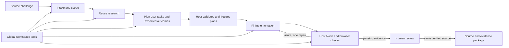

# AppYard challenge pipeline

AppYard now connects the Norfolk challenge catalog to Pi planning, implementation, verification and reviewed delivery. The pipeline chooses domain-specific skills and deterministic tools; each generated application keeps its own architecture.

The bundled catalog contains all **39 challenge IDs** returned by the [official Norfolk API](https://cdao.hackathon.maximus.com/api/events/norfolk/combined/), captured November 4, 2026. Each record comes from its official detail endpoint, including descriptions, requirements, expected deliverables, evaluation criteria, resources and links. Missing optional fields remain blank; missing categories remain `null`. Curated summaries, recipe assignments, data-needs suggestions and proposed acceptance tests are AppYard engineering decisions, separate from the official source.

Choose **Refresh from Norfolk** in the desktop catalog picker to import the current index and every detail record. The complete import is validated before replacing the saved catalog; offline or invalid responses leave the previous copy available. Saved projects retain their source snapshot, and refresh does not rewrite existing briefs. To update the bundled fallback for a release, run `npm run sync:norfolk` and `npm run test:norfolk`.

## Run it

Use Node 22.19 or later for the complete Pi development environment. The packaged desktop application includes its own runtime. From the repository:

```sh
npm run harness -- catalog
npm run harness -- plan 12
npm run harness -- plan 11 --out .fleet-runs/pb4t
npm run harness -- demo --out output/pipeline-demo
npm run test:harness
```

The CLI's `plan` command prepares a source-linked packet and reference toolkit. It does not claim that an AI has researched or implemented the application. `demo` executes eleven deterministic checks across six tool scenarios without a model, credential or network request; its report is explicitly toolkit-only. Use a fresh output directory for each demo report.

To call a tool with a JSON input:

```sh
npm run --silent harness -- fixture fleet_extract_messages > /tmp/fleet-message.json
npm run --silent harness -- tool fleet_extract_messages --input /tmp/fleet-message.json
```

Browser verification requires a browser runtime in addition to Node. From a source checkout, run `npm run setup:browser` once to install Playwright Chromium. The runner tries installed Playwright Chromium first, then installed Google Chrome. Packaged users need Google Chrome installed. Builds do not download a browser; a missing runtime produces an actionable verification failure.

In the desktop app, create a challenge from the catalog, review its scope, connect a Pi model in settings, and start the run. Each run gets a separate workspace. Separate intake, research and planning sessions write the scope, reuse decisions, architecture, implementation plan and acceptance journeys. The host validates and freezes the acceptance and UX plans before implementation produces a working browser application and testable core. Verification runs Node tests and the planned browser journeys on desktop and narrow viewports. Either gate failing uses the same one-repair budget. The operator reviews the result and remaining requirements before exporting a package.

## Pipeline contracts



| Stage | Required output | Exit condition |
|---|---|---|
| Intake | Original requirements, `.fleet/packet.json`, derived `scope.md` | Audience, primary task, source requirements, evaluation criteria, deliverables, user criteria, data boundary and unknowns are explicit |
| Research | `research.md` | Primary-source leads and adopt/adapt/reject decisions; untested integrations labeled |
| Plan | `plan.md`, `test-matrix.md`, `system-design.json`, `acceptance-plan.json`, `ux-spec.json` | Architecture and intended user behavior are defined; every criterion is implemented with browser journeys or explicitly deferred with a reason; host validates and freezes both JSON plans |
| Build | `index.html`, core modules, tests, `README.md` user guide | Working task flows implement the frozen selectors and outcomes, followed by a guide to the actual application; plans remain unchanged |
| Verify | `verification.md`, host-owned test report, screenshots and traces | Node tests and every implemented browser check pass on desktop and narrow viewports; deferred criteria remain unverified and the guide matches the application |
| Review | Host-recorded decision | Human inspects the exact verified prototype revision, task evidence and remaining requirements |
| Deliver | Source/evidence bundle, `path-to-fleet.md` | Source still matches verification and approval; setup and remaining dependencies documented |

The runtime runs intake, research, planning, implementation and verification as separate, sequential agent sessions. Only one phase is active per run. Required artifacts and immutable inputs are checked before advancing. Planning must publish the architecture and quality plans before building begins. A fresh run preserves prior work by using a new directory. Sessions have bounded turns/time and verification has process and browser timeouts; failed verification remains visible.

Once implementation artifacts exist, the build session receives a dedicated prompt to write the application's `README.md` user guide. The guide must exist before verification starts, and missing/empty output gets one completion attempt within the build session's original budget. Verification and repair update the guide to match the actual application before independent tests bind the final source revision. The guide is available with the run's artifacts and is included in delivery exports.

### Acceptance and user experience contracts

Acceptance criteria retain IDs and provenance from challenge requirements, evaluation criteria, expected deliverables and user criteria. Recipe checks supplement those sources. Scope decisions cannot silently replace a source requirement with a smaller demonstration.

The host writes `.fleet/quality-contract.md` with the exact JSON formats. The planner writes `acceptance-plan.json` with each criterion's implemented/deferred disposition, expected outcome and journey references; a deferral requires a reason. Journeys contain declarative CSS-selector steps and literal expected results, with intentional primary and recovery tasks. The accompanying `ux-spec.json` records the audience, primary task, recognizable success outcome, screens and their primary actions, empty/loading/error/success states, persistence, recovery and keyboard behavior. Selectors and expected behavior form a build contract, rather than being derived from whatever the application happens to do.

The host validates and freezes both JSON files immediately after planning. Builder and repair agents can fix implementation and application tests, but cannot rewrite expected results, turn a failure into a deferral or weaken the UX contract. These expectations come from a separate planning agent; their protection reduces implementation drift, but does not make them independently validated SME ground truth. Domain facts and operational acceptance still need appropriate evidence.

The browser runner exercises the shipped application at desktop and narrow widths and records per-journey results. It captures screenshots and traces under `.quality-evidence/<contract hash>-<run>/<journey>-<viewport>.png` and `.zip`, referenced by the host's `test-report.json`. Agents initially have no dedicated browser tool and must not claim visual inspection they did not perform. They can use returned failure evidence for the one bounded repair; the host reruns both Node and browser checks afterward.

Every implemented check must pass before prototype review. The report tracks criterion and journey status and reports `requirementsMet` separately: deferred requirements stay unverified even if all scoped prototype checks pass. Human review evaluates whether the task flow is understandable and useful; browser automation does not establish complete usability, accessibility or operational readiness.

The UX guidance targets complete interactions, including recovery. For example, a review flow must distinguish unsaved edits from the committed revision being approved; a conflict flow must let users compare competing values and deliberately choose or edit the merged result. A static mockup, a preserved revision graph or a source-string assertion alone cannot demonstrate those tasks.

## Challenge families

| Recipe | Source challenge IDs | Implementation direction |
|---|---|---|
| Messages | 12, 22, 24 | Exact-span structured extraction; OCR and template matching are separate work for scans |
| Scheduling | 11 | Explicit candidate starts, roster constraints, feasibility and infeasibility explanations |
| Offline | 36, 44, 45 | Durable edits, immutable revision merging, reviewed conflict resolution, resumable transfers |
| Knowledge | 15, 20, 21, 33, 34, 39, 46 | Approved-source retrieval, freshness, exact citations and applicability review |
| Readiness | 13, 14, 19, 26, 32 | Source reconciliation, reviewed dependency graphs, unknown estimates and deadline margin |
| Cyber | 18, 25, 35 | Offline evidence, analyst handoff and staged changes with approval/rollback |
| Governance | 9, 16, 23 | Simulation-only agent contracts, resource leases, authority and halt behavior |
| Workflow | 8, 40, 41, 42, 43, 48 | Versioned records, routing, state transitions and explicit release authority |
| Physics | 10, 17 | Authoritative equations and SME reference cases before implementation |
| Fielding | 37 | Owner-supplied app, installation evidence, hosting and sustainment handoff |

Related IDs are retained rather than collapsed: an umbrella challenge and a narrower submission can share building blocks while keeping different source requirements and transition owners.

## Included skills and tools

Fifteen skills live under `skills/`: intake, research, planning, UX, evidence, messages, scheduling, offline, knowledge, readiness, cyber, governance, workflows, physics and delivery. The workspace contains the union of assigned skills; each agent session loads only the skills allotted to its phase. Human review and delivery list reference guidance but do not launch agent sessions. Skills describe decision boundaries and domain invariants; TypeBox schemas and the code enforce tool inputs.

### Tool hierarchy

`harness/phases.ts` defines two levels of tool access. The packet saves `globalTools` once, while each phase's `tools` contains only its additional tools. Effective access is the deduplicated union of both lists. A fresh Pi session receives exact tool names, never the `fleet_*` wildcard; the Codex adapter receives only the selected custom tools alongside its native workspace tools.

**Global tools:** `read`, `write`, `edit`, `bash`. These workspace capabilities are inherited by every agent phase. They do not imply permission to deploy, change requirements or access operational systems, and phase allocation is not an OS sandbox.

| Phase | Assigned skills | Additional phase tools |
|---|---|---|
| Intake | Intake | `fleet_get_challenge` |
| Research | Research, evidence, recipe domain skills | `fleet_search_evidence` |
| Plan | Planning, UX, evidence, recipe domain skills | `fleet_system_design` |
| Build | Recipe domain skills, UX, evidence, delivery | Recipe domain tools, `fleet_component_progress` |
| Verify / repair | Evidence, UX, recipe domain skills | Recipe domain tools, `fleet_component_progress` |
| Human review | Evidence guidance | No agent tools; preview, evidence and approval controls |
| Deliver | Delivery guidance | No agent tools; host integrity check and export |

For example, a scheduling build adds `fleet_solve_schedule`; a message build adds `fleet_extract_messages` and `fleet_search_evidence`. The host runs Node and browser tests during verification. There is no dedicated browser tool in the initial agent allocation. A repair stays within verification's allocation and is limited to one shared attempt across both gates.

The build flow in both interfaces exposes global tools, phase-specific tools, skills, inputs, outputs and the completion gate. Each run persists its assignments with the source packet. Older runs without saved assignments show the proposed assignments for the next run explicitly.

| Pi tool | Actual behavior | Boundary |
|---|---|---|
| `fleet_get_challenge` | Read the captured catalog and recipe | Does not refresh the event website |
| `fleet_extract_messages` | Parse synthetic EVENT/TASK lines with exact offsets | Not full USMTF, OCR or semantic extraction |
| `fleet_solve_schedule` | Bounded hard-constraint feasibility search | No invented fatigue policy, automatic recurrence or optimality claim |
| `fleet_reconcile_records` | Merge immutable histories and retain conflicting heads | No persistence, authentication or network transport |
| `fleet_plan_uploads` | Allocate a byte budget from acknowledged offsets | Does not transmit or acknowledge bytes |
| `fleet_search_evidence` | Filter and rank supplied approved documents lexically | No live source connector or semantic answer generation |
| `fleet_analyze_dependencies` | Calculate a DAG's timing, path and deadline margin | No validated mission-capability model or shared-resource solver |

All tools are local, deterministic transformations of supplied data. Input schemas reject extra properties, payload size is bounded, and outputs identify their scope. The matching dependency-free calculation modules are copied into `.fleet/toolkit/` for generated applications to reuse. They do not impose a common runtime on delivered apps.

## Integration points

- `harness/catalog.ts`: typed catalog, `getChallenge`, and `toProjectInput` for the desktop picker.
- `harness/recipes.ts`: approaches, selected skills/tools, component candidates, acceptance criteria and limitations.
- `harness/phases.ts`: global tools, phase-specific tools, skills, owners and completion gates.
- `harness/planner.ts`: packet composition and stage-specific instructions.
- `harness/integration.ts`: `prepareFleetWorkspace`, `fleetStagePrompt`, `assertFleetPacketIntegrity`.
- `harness/pi-tools.ts`: `createFleetTools()` for Pi `customTools`.
- `harness/tool-registry.ts`: input schemas and a shared invocation path for Pi and the CLI.
- `harness/tools/`: reusable deterministic primitives without Pi dependencies.

The host retains `packetHash` outside the agent workspace and rechecks context integrity before accepting verification. Changing a skill, source packet or reference toolkit invalidates that context, even if the editable manifest hash is forged. Original requirements and the post-planning frozen contracts are checked separately by the desktop host. Verification and export bind evidence to source hashes. These checks catch changes during the trusted local workflow; they are not an adversarial OS sandbox or a cryptographic government identity system.

## Reuse decisions

Pi is the chosen coding backend. The application already integrates its SDK, credentials and activity stream, so the challenge layer extends that interface instead of installing another orchestrator. [SWE-AF](https://github.com/Agent-Field/SWE-AF) remains a future candidate for a separately evaluated distributed factory. This implementation does not claim to have benchmarked SWE-AF, SuperPlane, Symphony or Aperant.

Each recipe records source-backed component candidates rather than silently installing everything:

- [OR-Tools scheduling](https://developers.google.com/optimization/scheduling): evaluate when the small feasibility baseline needs richer objectives or larger instances.
- [PouchDB replication](https://pouchdb.com/guides/replication.html): evaluate established replication and conflict retention for real offline deployment.
- [SQLite FTS5](https://sqlite.org/fts5.html): consider an embedded full-text baseline before embeddings.
- [Tika](https://tika.apache.org/) and [Tesseract](https://github.com/tesseract-ocr/tesseract): evaluate file ingestion and OCR separately against actual input formats.
- [OPA](https://www.openpolicyagent.org/docs) and [OpenSCAP](https://www.open-scap.org/): evaluate policy decisions and defensive baseline assessment in an authorized lab.
- [NetworkX DAG algorithms](https://networkx.org/documentation/stable/reference/algorithms/dag.html): consider larger dependency analysis after validating the domain graph.
- [Power Apps](https://learn.microsoft.com/en-us/power-apps/): evaluate for challenges that explicitly require the existing Microsoft 365 platform.

Selection still requires version/license review and a task-specific spike. The simple built-in algorithms make the pipeline demonstrable offline; they are bounded reference primitives, not substitutes for those deployment evaluations.

## First demonstrations and remaining work

Start with **12 → 11 → 36**. This tests three different engineering problems: preserving evidence while extracting fields, finding feasible constrained schedules, and reconciling disconnected state. Compare each generated app against independently reviewed expectations before expanding to adjacent challenges.

The catalog and pipeline cover all 39 challenges; they are not 39 finished applications. Important external requirements remain explicit: approved USMTF mappings, handwritten scan accuracy, SFTRM/fatigue rules, true device persistence/encryption, authorized data connectors, real identity/PKI, engineering formulae, operational owners and deployment authorization. No hosted model-quality evaluation is implied by the offline toolkit or local fixture-provider tests.

To extend the system, add a source-linked challenge or recipe, provide a discriminating skill, register a typed tool only when deterministic behavior is useful, and test it against independent expected outcomes. Add integration capabilities as separately reviewed adapters rather than hiding them inside a language-model prompt.
