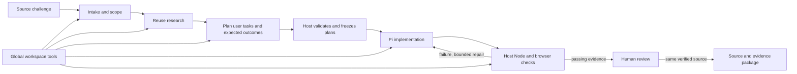

# AppYard challenge pipeline

AppYard now connects the Norfolk challenge catalog to Pi planning, implementation, verification and reviewed delivery. The pipeline chooses domain-specific skills and deterministic tools; each generated application keeps its own architecture.

The bundled catalog contains all **39 challenge IDs** returned by the [official Norfolk API](https://cdao.hackathon.maximus.com/api/events/norfolk/combined/), captured November 4, 2026. Each record comes from its official detail endpoint, including descriptions, requirements, expected deliverables, evaluation criteria, resources and links. Missing optional fields remain blank; missing categories remain `null`. Curated summaries, recipe assignments, data-needs suggestions and proposed acceptance tests are AppYard engineering decisions, separate from the official source.

Choose **Refresh from Norfolk** in the desktop catalog picker to import the current index and every detail record. The complete import is validated before replacing the saved catalog; offline or invalid responses leave the previous copy available. Saved projects retain their source snapshot, and refresh does not rewrite existing briefs. To update the bundled fallback for a release, run `npm run sync:norfolk` and `npm run test:norfolk`.

The planning agent selects a versioned [application foundation](application-foundations.md) and computation pack based on its domain recipe. After validating the runtime contract, the host copies the starter into the workspace before implementation, records its original file hashes in `foundation-lock.json`, and lets the builder extend the shared backend. Both Pi and Codex use this path. See [starter research](application-foundations-research.md) for upstream candidates and adoption decisions.

## Run it

Use Node 22.19 or later for the complete Pi development environment. The packaged desktop application includes its own runtime. From the repository:

```sh
npm run harness -- catalog
npm run harness -- plan 12
npm run harness -- plan 11 --out .fleet-runs/pb4t
npm run harness -- demo --out output/pipeline-demo
npm run test:harness
```

The CLI's `plan` command prepares a source-linked packet and reference toolkit. It does not claim that an AI has researched or implemented the application. `demo` executes eleven deterministic checks across six tool scenarios without a model, credential or network request; its report is explicitly toolkit-only. Use a fresh output directory for each demo report.

To call a tool with a JSON input:

```sh
npm run --silent harness -- fixture fleet_extract_messages > /tmp/fleet-message.json
npm run --silent harness -- tool fleet_extract_messages --input /tmp/fleet-message.json
```

Browser verification requires a browser runtime in addition to Node. From a source checkout, run `npm run setup:browser` once to install Playwright Chromium. The runner tries installed Playwright Chromium first, then installed Google Chrome. Packaged users need Google Chrome installed. Builds do not download a browser; a missing runtime produces an actionable verification failure.

Final browser verification permits one download only while executing a frozen `expectDownload` step. The existing filename, content, size and completion checks still apply. Downloads during page load, ordinary actions or evidence capture, and additional downloads from an export action, are cancelled and fail the journey at either viewport. The failure remains in the journey report alongside its screenshot and trace.

In the desktop app, create a challenge from the catalog, review its scope, connect a Pi model in settings, and start the run. Each run gets a separate workspace. Separate intake, research and planning sessions write the scope, reuse decisions, architecture, implementation plan and acceptance journeys. The host validates and freezes solution, evaluation, acceptance and UX contracts. It evaluates the declared computational core before application completion, then runs developer tests and capability checks in a clean package plus applicable browser journeys. Before expanding the interface, the host runs the first frozen primary user journey at both widths. Core, primary-workflow and final verification have separate counts and fifteen active repair minutes per gate. Core permits one correction per build attempt and two across recovery, final verification two automatic repairs, and the primary workflow up to three repairs with a stop after two successive checks without semantic progress. Attempts and consumed time survive resume. The operator reviews the result and remaining requirements before exporting a package.

## Computational solution contracts

New builds use acceptance schema version 2 and produce `solution-contract.json` and `evaluation-plan.json` during planning. Capabilities can combine algorithms, optimization, prediction, retrieval, generation and stateful workflows. Required capabilities cannot be deferred. The host seals evaluation answers outside the builder workspace, scores the actual runtime in a fresh copy, and uses the same bounded repair policy for core and final verification. It restores the frozen evaluation plan to successful exports for reproducibility. Legacy version 1 reports remain readable.

Browser, CLI and loopback service profiles declare entrypoints, delivery files, locked dependencies and required environment names. CLI/service solutions export as runnable source packages with startup instructions. Browser solutions retain standalone app packaging. Missing models, dependencies or configuration fail explicitly. See [solution evaluation](solution-evaluation.md) for exact schemas, scorer boundaries and `npm run benchmark:factory`.

## Pipeline contracts



| Stage | Required output | Exit condition |
|---|---|---|
| Intake | Original requirements, `.fleet/packet.json`, derived `scope.md`, `inputs/manifest.json`; synthetic data and documentation when no inputs were supplied | Scope and data boundaries are explicit; supplied inputs are copied or a dedicated data agent produces validated use-case fixtures |
| Research | `research.md` | Primary-source leads and adopt/adapt/reject decisions; untested integrations labeled |
| Plan | `plan.md`, `test-matrix.md`, `system-design.json`, `acceptance-plan.json`, `ux-spec.json`, `solution-contract.json`, `evaluation-plan.json` | Architecture and intended user behavior are defined; every criterion maps to capability checks and/or applicable browser journeys, or is explicitly deferred with a reason; required core capabilities cannot be deferred; host freezes all contracts and seals the answer key |
| Build | Declared runtime files, core modules, tests, `README.md`, core evaluation evidence, recorded visual reviews | Core capability evaluation passes before application completion; browser/service apps have initial reviews and fresh rechecks at both widths with all findings resolved against final runtime files |
| Verify | `verification.md`, host-owned test report, `visual-review.json`, screenshots and traces | Node tests and every implemented browser check pass on desktop and narrow viewports; the verifier completes its own visual review loop; deferred criteria remain unverified and the guide matches the application. CLI apps do not require visual review |
| Review | Host-recorded decision | Human inspects the exact verified app revision, task evidence and remaining requirements |
| Deliver | Source/evidence bundle, `path-to-fleet.md` | Source still matches verification and approval; setup and remaining dependencies documented |

The runtime runs intake, research, planning, implementation and verification as separate, sequential agent sessions. Only one phase is active per run. Required artifacts and immutable inputs are checked before advancing. Planning must publish the architecture and quality plans before building begins. A fresh run preserves prior work by using a new directory. Worker sessions have no default turn-count or elapsed-time limit; five minutes of inactivity and any explicitly configured deadline still stop the session. The separate planning reviewer uses these worker defaults with an additional 64-turn limit. Text, reasoning, tool activity and provider retry events refresh inactivity; progress messages do not manufacture a heartbeat. Verification has process and browser timeouts, and failed verification remains visible.

Application verification requires every discovered test file to complete at least one `node:test` case (`test()` or `it()`). Empty modules, top-level assertions and printed success messages cannot substitute for executed cases. Skipped or todo tests and suites block verification. Both ordinary and isolated candidate runners derive counts from structured runner events while retaining readable TAP diagnostics. This establishes test execution; the independent capability and browser checks still assess application behavior.

The test command in new reports reruns the application tests with Node's standard reporter. Arguments are quoted for a POSIX shell (macOS or Linux), so filenames containing spaces, quotes or shell substitutions remain literal. Delivery notes regenerate this command from the verified test-file inventory, including when exporting an older report. Follow the application's README prerequisites and run from the bundle directory. This developer command does not reproduce AppYard's private completed-case evidence, source integrity, capability or browser gates, and does not renew verification or approval. Host verification continues to use its structured reporter; saved reports are not rewritten.

Failed and stopped runs with a persisted checkpoint can resume from the interrupted phase. The phase panel and journey header show a **Resume** action. Resuming keeps the run ID, workspace, saved files and completed phases, validates protected inputs and frozen contracts, and creates a fresh agent session for the interrupted phase. It does not restore the old model conversation. Each explicit resume grants one new repair attempt; it never skips independent verification. Resume preserves failed-attempt metrics and the test baseline frozen at the end of the build stage. Unconfirmed writers or process cleanup block recovery. Planning corrections and fresh independent reviews repeat automatically until approval. Each correction preserves a durable snapshot of the latest valid plan. Resuming an interrupted correction continues that pending revision or review using the saved findings. **Start new build** creates a separate run from the current brief. Older runs without a trusted checkpoint use that new-build path; their saved outputs stay available.

After revising the brief of an unfrozen ordinary plan, **Continue planning** copies the validated prepared data, completed scope and research, and existing planning drafts into a separate planning attempt. It keeps the original workspace and checkpoint intact, writes the revised requirements and acceptance criteria, and starts at planning with the previous review findings. Previously answered human clarifications remain historical context in the revised requirements, including across repeated continuations; the revised brief takes precedence and old questions are not reopened. Intake, synthetic data generation and research stay complete. The planner must reconcile prior drafts with the revised requirements and obtain fresh independent approval. This continuation requires unchanged attached input data and source challenge; frozen builds retain their original requirements and contracts.

Pending starts and resumes reserve a concurrency slot while authentication is checked. Stop and application shutdown cancel that preparation without waiting for authentication to finish; a late response cannot launch the cancelled build. Until authentication succeeds, the previous run, workspace and review evidence remain unchanged. Authentication failures and cancelled preparations release their slot.

Briefs can include attached UTF-8 text files or named pasted inputs. The host copies these to `inputs/` before agent work and records their provenance in `inputs/manifest.json`. When the brief has no actual inputs, intake launches a separate synthetic-data session after `scope.md` exists. Resource notes and reference URLs alone do not suppress this fallback. The session writes `data/synthetic-data.json` and `data/README.md`, describing the use case, field types, representative records, typical/edge/invalid scenarios and limitations. The host validates the schema and scenarios, then freezes the data for research, planning, developer examples and tests. Both supplied input copies and generated fixtures receive integrity checks at subsequent handoffs. The selected engine, cancellation and session budgets apply to the data agent too; invalid output can receive one completion attempt before the build fails.

The delivery target is the functional application, with real workflows and documented plugin and data connector interfaces. Users implement their plugins and connectors after the agents finish the build. Plans and generated user guides must identify these extension points, data contracts, configuration requirements, and validation steps. Missing integrations produce accurate setup or empty states; they must not produce invented connection success, synchronization, or operational records. The app UI uses normal product language without synthetic-data, mock, demo, or prototype banners. Fixture provenance and limitations remain explicit in developer and test artifacts, and development fixtures stay out of live-looking operational views.

Once implementation artifacts exist, the build session receives a dedicated prompt to write the application's `README.md` user guide. The guide must exist before verification starts, and missing/empty output gets one completion attempt within the build session's original budget. Verification and repair update the guide to match the actual application before independent tests bind the final source revision. The guide is available with the run's artifacts and is included in delivery exports.

Brief-data validation and integrity checks, and ordinary/shared planning-review capture and rechecks, require valid UTF-8 bytes. Malformed sequences fail before text decoding, so different source bytes cannot silently become the same replacement character and reuse a frozen identity. Valid Unicode, a literal replacement character, byte-order marks and line endings remain unchanged, retaining existing hashes for valid files. Invalid generated data can use the existing completion attempt; invalid supplied data must be corrected for a new run. Planning diagnostics identify the affected document without reproducing its contents.

### Acceptance and user experience contracts

Acceptance criteria retain IDs and provenance from challenge requirements, evaluation criteria, expected deliverables and user criteria. Recipe checks supplement those sources. Scope decisions cannot silently replace a source requirement with a smaller demonstration.

The host writes `.fleet/quality-contract.md` with the exact JSON formats. The planner writes `acceptance-plan.json` with each criterion's implemented/deferred disposition, expected outcome and journey references; a deferral requires a reason. Journeys contain declarative CSS-selector steps and literal expected results, with intentional primary and recovery tasks. The accompanying `ux-spec.json` records the audience, primary task, recognizable success outcome, screens and their primary actions, empty/loading/error/success states, persistence, recovery and keyboard behavior. Selectors and expected behavior form a build contract, rather than being derived from whatever the application happens to do.

New browser/service plans use UX version 2: a justified interaction pattern, entry screen, navigation, persistent elements, and each screen's route, unique root selector, layout, secondary disclosure and narrow behavior. The planner sketches this structure in `plan.md`; implementation builds the navigation and layout before placing feature controls. Multiple HTML pages, service routes and client-side views are supported. Each regular journey starts with an entry `expectScreen`, and every planned screen must be reached and checked. The host verifies the active route/root and that all other screen roots are hidden or absent, so stacking every planned screen visibly fails. `expectHidden` checks secondary disclosures. New experiment browser candidates supply the same structure in execution-contract version 2 and append screen assertions to their immutable shared steps. Existing frozen version 1 contracts and CLI plans remain compatible. See [generated application structure](ui-structure.md) for the contract, runtime routes and regression scope.

Before freezing a new regular or shared experiment plan, the host checks that every required or claimed capability has host evaluations and that each of its criterion mappings points to an implemented criterion that references the capability. This includes optional capabilities used as evidence: without evaluations they would remain unverified, and a deferred or one-sided mapping would prevent approval regardless of implementation quality. The planner receives a correction diagnostic before building. Unused optional capabilities may remain unevaluated; already-frozen contracts retain their original interpretation.

Before freezing a new regular or shared experiment plan, the host requires every recovery journey to contain an action, an observation, a later correction or retry, and a literal outcome. Error visibility is a valid intermediate observation; success must use `expectText`, `expectValue` or download content. Inline input correction and reload retries are supported, and a content-checked download may combine retry and outcome. Opening help, stopping after an error, or asserting only visibility after retry fails planning and uses the existing completion attempt. This gate checks ordering; it does not prove that the observations represent a real failure and recovery, or that the planned scope is sufficient. Previously frozen regular and experiment contracts retain their original interpretation on resume; no saved expectations are rewritten.

Ordinary planning sessions also receive the current quality-contract guide directly from the running host, including when resuming a packet created by an older app version. This guidance supersedes conflicting schema examples in the saved guide without changing the protected `.fleet` packet. The planning-only `fleet_validate_plan` tool checks the saved quality, invocation and foundation contracts using the same validator as the completion gate. Agents can correct and recheck schema errors before ending their turn, subject to inactivity and any explicitly configured deadline. Validation never edits or freezes contracts, and it does not replace the independent planning review or expand the one completion/repair allowance. Already frozen contracts retain their original interpretation.

New regular builds and shared architecture-comparison plans receive an independent planning review before contracts freeze or evaluation answers are sealed. Regular builds complete this review before foundation files are copied. A fresh session using the selected Pi or Codex model can only read an immutable snapshot and submit a structured verdict. It assesses every original acceptance criterion and evaluation, the minimum useful user outcome, justified deferrals, public protocol consistency, trivial passing implementations, boundaries and meaningful recovery. Constant outputs are permitted when the actual task warrants them; there is no blanket answer-diversity quota. This model judgment supplements deterministic validation and does not establish domain expertise or operational readiness.

New planning reviews also capture the exact host-frozen prepared data inventory: the input manifest and attached files, or the validated synthetic dataset and its README. The reviewer must read every page of these immutable copies before approving, and assess fields, units, formats, limitations and scenarios against the planned workflow and evaluations. The host binds the data identity to the review and rejects changed or missing data before freeze. Only the recorded prepared files are exposed; workspace additions and manifest text cannot expand access. Existing frozen approvals and already-recorded legacy shared approvals keep their original interpretation on recovery. This establishes access to the data, not the accuracy of the reviewer’s judgment.

The host binds the verdict to hashes of the exact reviewed documents and contract, rechecks them before freezing, and keeps the full record in private run or experiment records. Before accepting a new approval, the host also requires the review session to read every page of every captured document, including clarifications when present. It tracks returned character ranges, so repeated pages, end-of-file requests and skipped sections cannot satisfy this requirement. An incomplete approval receives document names and the first unread offsets and can be retried after reading; an actionable revision may be submitted early. This establishes document delivery, not comprehension or review accuracy. Existing saved approvals retain their original interpretation. Agent-authored verdict files, missing submissions, malformed assessments and changed plans cannot authorize building. A rejection starts an automatic planner correction followed by a fresh review, repeating until approval. A durable snapshot protects the latest valid plan during each correction. Interrupted corrections resume from their saved revision or review state. Eligible saved rejections from the former revision limit resume as pending corrections; already-frozen checkpoints retain their original contracts.

Shared planning reviews the original requirements, scope, research, architecture-neutral behavior, private evaluations, available operations and any clarified decisions. It reviews the shared product surface and permitted delivery options before candidates choose runtimes or UI bindings. Its private experiment state preserves the pending revision or review and latest findings across restart. Repeated requests for changes continue automatically within the existing shared-planning execution budget; saved rejections from the former one-revision limit resume as pending revisions. Already-frozen shared plans keep their original contracts. Paired and adaptive ordinary builds use this shared review as well.

Regular acceptance plans can explicitly test an HTTP validation rejection with `{"action":"expectHttpError","selector":"#save","path":"/api/tasks","method":"POST","status":422}`. The host clicks the control and requires a new same-origin fetch/XHR response matching the exact path/query, method and 400–499 status. Only the native browser resource diagnostic attributed to that request is excused; undeclared or extra failures, assets, navigation, transport failures, server errors and application `console.error` calls still fail. Journeys must still assert the visible error and successful correction. Both development journeys and independent verification use the same response evidence. This action is not part of the architecture-neutral experiment scenario format.

The host validates and freezes all four JSON contracts immediately after planning. It retains the evaluation plan outside the builder workspace until successful verification. Builder and repair agents can fix implementation and application tests, but cannot rewrite frozen solution or acceptance contracts, recreate sealed evaluation keys, or rewrite expected results, turn a failure into a deferral or weaken the UX contract. These expectations come from a separate planning agent; their protection reduces implementation drift, but does not make them independently validated SME ground truth. Domain facts and operational acceptance still need appropriate evidence.

Quality contract loading, ordinary frozen-contract checks, and comparisons of all seven public experiment documents reject malformed UTF-8 before decoding. Invalid bytes cannot impersonate a literal replacement character and pass the unchanged-contract check. Diagnostics identify the file without echoing its contents. Valid Unicode, existing contract hashes, and evaluation sealing and restoration keep their current behavior; no saved contract is rewritten.

The browser runner exercises the shipped application at desktop and narrow widths and records per-journey results. It captures screenshots and traces under `.quality-evidence/<contract hash>-<run>/<journey>-<viewport>.png` and `.zip`, referenced by the host's `test-report.json`. Build and verification agents also have [an interactive browser tool](agent-browser.md) that returns actual screenshots and console errors for development. They must run every frozen journey at both widths, review each screenshot, fix defects and rerun against the final files. The host allows up to three visual completion follow-ups while progress continues, subject to inactivity and any explicitly configured deadline. Its observations under `.browser-observations/` remain separate from independent acceptance evidence. Agents can use independent failure evidence for bounded functional repairs; the host reruns both Node and browser checks afterward.

Every implemented check must pass before app review. The report tracks criterion and journey status and reports `requirementsMet` separately: deferred requirements stay unverified even if all scoped application checks pass. Human review evaluates whether the task flow is understandable and useful; browser automation does not establish complete usability, accessibility or operational readiness.

The UX guidance targets complete interactions, including recovery. For example, a review flow must distinguish unsaved edits from the committed revision being approved; a conflict flow must let users compare competing values and deliberately choose or edit the merged result. A static mockup, a preserved revision graph or a source-string assertion alone cannot demonstrate those tasks.

## Challenge families

| Recipe | Source challenge IDs | Implementation direction |
|---|---|---|
| Messages | 12, 22, 24 | Exact-span structured extraction; OCR and template matching are separate work for scans |
| Scheduling | 11 | Explicit candidate starts, roster constraints, feasibility and infeasibility explanations |
| Offline | 36, 44, 45 | Durable edits, immutable revision merging, reviewed conflict resolution, resumable transfers |
| Knowledge | 15, 20, 21, 33, 34, 39, 46 | Approved-source retrieval, freshness, exact citations and applicability review |
| Readiness | 13, 14, 19, 26, 32 | Source reconciliation, reviewed dependency graphs, unknown estimates and deadline margin |
| Cyber | 18, 25, 35 | Offline evidence, analyst handoff and staged changes with approval/rollback |
| Governance | 9, 16, 23 | Simulation-only agent contracts, resource leases, authority and halt behavior |
| Workflow | 8, 40, 41, 42, 43, 48 | Versioned records, routing, state transitions and explicit release authority |
| Physics | 10, 17 | Authoritative equations and SME reference cases before implementation |
| Fielding | 37 | Owner-supplied app, installation evidence, hosting and sustainment handoff |

Related IDs are retained rather than collapsed: an umbrella challenge and a narrower submission can share building blocks while keeping different source requirements and transition owners.

## Included skills and tools

Eighteen skills live under `skills/`: sixteen Fleet skills plus bundled Ponytail and Impeccable. The workspace contains the union of assigned skills, including `fleet-data` for the conditional synthetic-data session; each Pi or Codex agent session loads only its assigned skills. Skill folders include their references, scripts and assets, with file bytes and executable permissions covered by packet integrity checks. Human review and delivery list reference guidance but do not launch agent sessions. Skills describe decision boundaries and domain invariants; TypeBox schemas and the code enforce tool inputs.

Ponytail guides reuse and simple, complete implementations during research, planning, build and verification. Impeccable guides UI planning, implementation and review alongside `fleet-ux`. Planning has Impeccable available while deciding the runtime; once a CLI contract is frozen, the host removes it from build and verification sessions and their saved phase assignments. Browser and service profiles retain it. The immutable packet records the initial allocation; the project's saved phase plan records the runtime-specific allocation.

The bundled entrypoints adapt upstream guidance to the current phase: no extra agents, approval loops, installation, global hooks or changes to frozen contracts. The existing host gates and bounded functional repair policy remain authoritative. Impeccable's optional engine commands use an offline launcher; when no compatible engine is supplied, agents read the packaged guidance and project context directly and report unavailable checks. Upstream versions, licenses and adaptations are recorded in [third-party skill provenance](../skills/THIRD_PARTY.md).

### Tool hierarchy

`harness/phases.ts` defines two levels of tool access. The packet saves `globalTools` once, while each phase's `tools` contains only its additional tools. Effective access is the deduplicated union of both lists. A fresh Pi session receives exact tool names, never the `fleet_*` wildcard; the Codex adapter receives only the selected custom tools alongside its native workspace tools.

**Global tools:** `read`, `write`, `edit`, `bash`, `fleet_helpers`, `fleet_run_helper`. Every agent phase inherits workspace capabilities plus discovery, testing and direct execution of [project-local agent helpers](agent-helpers.md). Helpers live in `.agent-tools/`, are tested before use, and are reused across phases. They have full filesystem, subprocess and network access, including self-hosted browsers. They inherit the run process marker so Stop and final cleanup end their descendants. Human approval, frozen contracts and independent verification still govern delivery.

| Phase | Assigned skills | Additional phase tools |
|---|---|---|
| Intake | Intake | `fleet_get_challenge` |
| Research | Research, evidence, recipe domain skills, Ponytail | `fleet_search_evidence` |
| Plan | Planning, UX, evidence, recipe domain skills, Ponytail, Impeccable for UI planning | `fleet_system_design` |
| Build | Recipe domain skills, UX, evidence, delivery, Ponytail, Impeccable for browser/service | Recipe domain tools, `fleet_component_progress`, `fleet_browser` |
| Verify / repair | Evidence, UX, recipe domain skills, Ponytail, Impeccable for browser/service | Recipe domain tools, `fleet_component_progress`, `fleet_browser` |
| Human review | Evidence guidance | No agent tools; preview, evidence and approval controls |
| Deliver | Delivery guidance | No agent tools; host integrity check and export |

For example, a scheduling build adds `fleet_solve_schedule`; a message build adds `fleet_extract_messages` and `fleet_search_evidence`. Build and verification agents use `fleet_browser` to open the declared app, click/type, inspect screenshots and console errors, and reopen after source edits. The host runs independent Node and browser tests during verification. A repair stays within verification's allocation and is limited to separate bounded allowances for core, workflow and final gates.

The build flow in both interfaces exposes global tools, phase-specific tools, skills, inputs, outputs and the completion gate. Each run persists its assignments with the source packet. Older runs without saved assignments show the proposed assignments for the next run explicitly.

| Pi tool | Actual behavior | Boundary |
|---|---|---|
| `fleet_get_challenge` | Read the captured catalog and recipe | Does not refresh the event website |
| `fleet_extract_messages` | Parse synthetic EVENT/TASK lines with exact offsets | Not full USMTF, OCR or semantic extraction |
| `fleet_solve_schedule` | Bounded hard-constraint feasibility search | No invented fatigue policy, automatic recurrence or optimality claim |
| `fleet_reconcile_records` | Merge immutable histories and retain conflicting heads | No persistence, authentication or network transport |
| `fleet_plan_uploads` | Allocate a byte budget from acknowledged offsets | Does not transmit or acknowledge bytes |
| `fleet_search_evidence` | Filter and rank supplied approved documents lexically | No live source connector or semantic answer generation |
| `fleet_analyze_dependencies` | Calculate a DAG's timing, path and deadline margin | No validated mission-capability model or shared-resource solver |

These domain tools are local, deterministic transformations of supplied data. Input schemas reject extra properties, payload size is bounded, and outputs identify their scope. The matching dependency-free calculation modules are copied into `.fleet/toolkit/` for generated applications to reuse. They do not impose a common runtime on delivered apps.

Timestamp inputs (`asOf`, document `updatedAt`, and upload `createdAt`) require a valid date and time with an explicit timezone, for example `2026-11-04T12:00:00Z` or `2026-11-04T07:00-05:00`. Whole seconds are optional; fractional seconds, date-only values and local times without a timezone are unsupported. Years must be at least 1900 and offsets must be within ±14:00. The agent tool schemas and `.fleet/tool-schemas.json` advertise this syntax; the runtime also rejects impossible calendar dates. Errors for malformed or impossible timestamp strings identify the field and provide valid examples without echoing the supplied value.

## Integration points

- `harness/catalog.ts`: typed catalog, `getChallenge`, and `toProjectInput` for the desktop picker.
- `harness/recipes.ts`: approaches, selected skills/tools, component candidates, acceptance criteria and limitations.
- `harness/phases.ts`: global tools, phase-specific tools, skills, owners and completion gates.
- `harness/planner.ts`: packet composition and stage-specific instructions.
- `harness/integration.ts`: `prepareFleetWorkspace`, `fleetStagePrompt`, `assertFleetPacketIntegrity`.
- `harness/pi-tools.ts`: `createFleetTools()` for Pi `customTools`.
- `harness/tool-registry.ts`: input schemas and a shared invocation path for Pi and the CLI.
- `harness/tools/`: reusable deterministic primitives without Pi dependencies.

The host retains `packetHash` outside the agent workspace and rechecks context integrity before accepting verification. Changing a skill, source packet or reference toolkit invalidates that context, even if the editable manifest hash is forged. Original requirements and the post-planning frozen contracts are checked separately by the desktop host. Verification and export bind evidence to source hashes. These checks catch changes during the trusted local workflow; they are not an adversarial OS sandbox or a cryptographic government identity system.

## Reuse decisions

Pi is the chosen coding backend. The application already integrates its SDK, credentials and activity stream, so the challenge layer extends that interface instead of installing another orchestrator. [SWE-AF](https://github.com/Agent-Field/SWE-AF) remains a future candidate for a separately evaluated distributed factory. This implementation does not claim to have benchmarked SWE-AF, SuperPlane, Symphony or Aperant.

Each recipe records source-backed component candidates rather than silently installing everything:

- [OR-Tools scheduling](https://developers.google.com/optimization/scheduling): evaluate when the small feasibility baseline needs richer objectives or larger instances.
- [PouchDB replication](https://pouchdb.com/guides/replication.html): evaluate established replication and conflict retention for real offline deployment.
- [SQLite FTS5](https://sqlite.org/fts5.html): consider an embedded full-text baseline before embeddings.
- [Tika](https://tika.apache.org/) and [Tesseract](https://github.com/tesseract-ocr/tesseract): evaluate file ingestion and OCR separately against actual input formats.
- [OPA](https://www.openpolicyagent.org/docs) and [OpenSCAP](https://www.open-scap.org/): evaluate policy decisions and defensive baseline assessment in an authorized lab.
- [NetworkX DAG algorithms](https://networkx.org/documentation/stable/reference/algorithms/dag.html): consider larger dependency analysis after validating the domain graph.
- [Power Apps](https://learn.microsoft.com/en-us/power-apps/): evaluate for challenges that explicitly require the existing Microsoft 365 platform.

Selection still requires version/license review and a task-specific spike. The simple built-in algorithms make the pipeline demonstrable offline; they are bounded reference primitives, not substitutes for those deployment evaluations.

## First demonstrations and remaining work

Start with **12 → 11 → 36**. This tests three different engineering problems: preserving evidence while extracting fields, finding feasible constrained schedules, and reconciling disconnected state. Compare each generated app against independently reviewed expectations before expanding to adjacent challenges.

The catalog and pipeline cover all 39 challenges; they are not 39 finished applications. Important external requirements remain explicit: approved USMTF mappings, handwritten scan accuracy, SFTRM/fatigue rules, true device persistence/encryption, authorized data connectors, real identity/PKI, engineering formulae, operational owners and deployment authorization. No hosted model-quality evaluation is implied by the offline toolkit or local fixture-provider tests.

To extend the system, add a source-linked challenge or recipe, provide a discriminating skill, register a typed tool only when deterministic behavior is useful, and test it against independent expected outcomes. Add integration capabilities as separately reviewed adapters rather than hiding them inside a language-model prompt.
